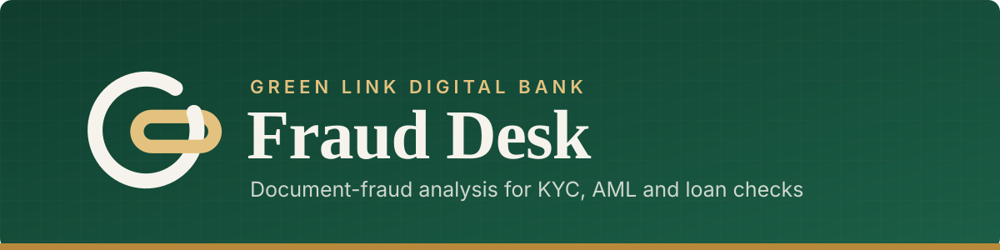
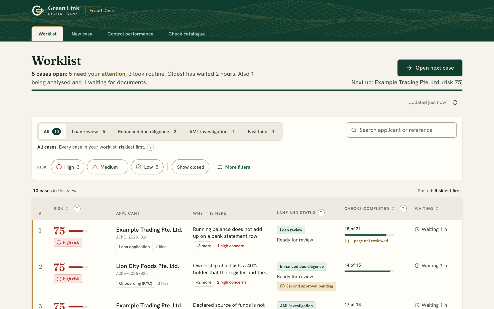
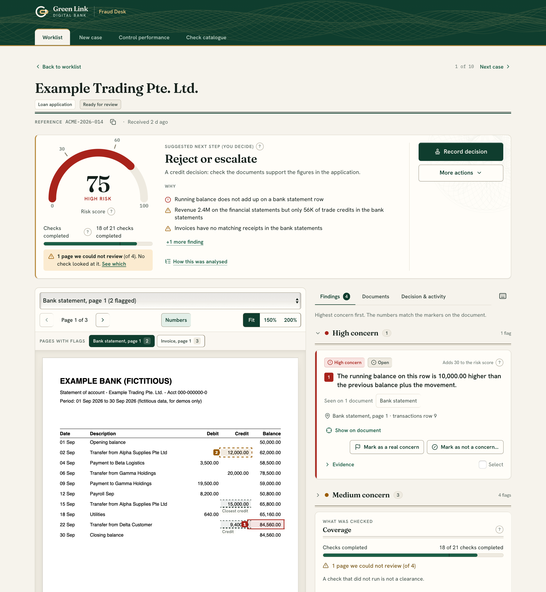
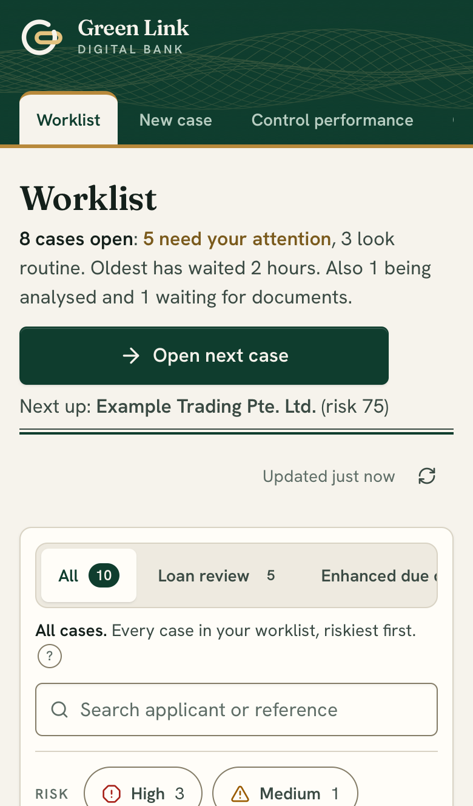
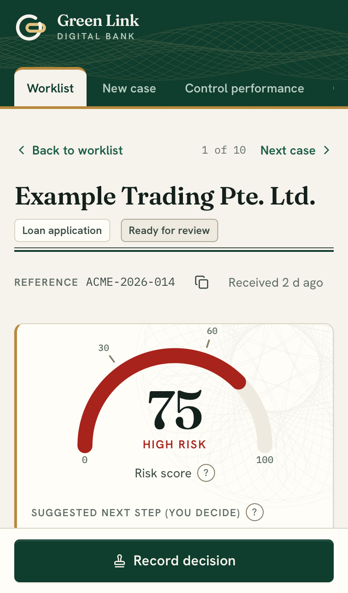
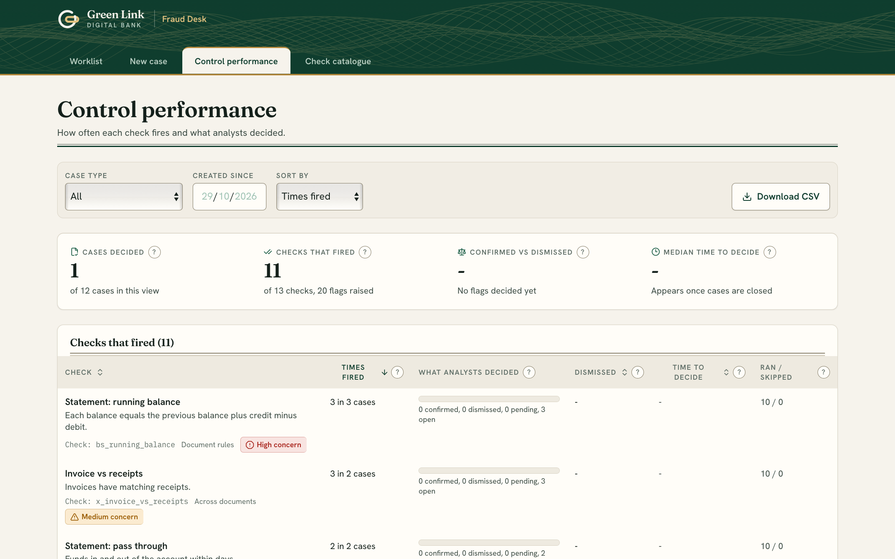

<h3>Upload a bundle of documents. Get a ranked queue of cases, with the evidence behind every flag.</h3>

  
  
  
  
  
  

  
  
  
  

[Features](#key-features) · [See it](#see-it) · [How it works](#how-it-works) · [Try it](#try-it) · [Results](#results) · [Contributors](#contributors)

---

## Key features

Fraud Desk reads a bundle of documents, runs the checks an analyst would do by hand, and ranks the cases that need a person.

- **Riskiest cases first.** A score and a one-line plain-English reason for each case. Analysts make every decision.
- **Evidence you can see.** Each flag is highlighted on the exact figure on the exact page, and every score shows its coverage: which checks ran and which pages went unreviewed.
- **69 rule-based checks plus 5 model-based, across 13 document types.** The rule-based ones cover statement, invoice, receipt and financial-statement arithmetic, ID and ownership records, cross-document reconciliation, name matching, file forensics. The model-based ones read meaning and quote the text they rely on (name linking is opt-in). Optional outside sources: ACRA company lookup, sanctions lists, GLEIF ([docs/verification-sources.md](docs/verification-sources.md)).
- **Review team and workflow.** Four specialist reviewers and a case officer summarise each flagged case. Verdicts need a reason, high-severity dismissals need a second approver, and everything lands in an append-only audit log ([docs/agents.md](docs/agents.md)).
- **Your own checks, optional.** Describe a check in plain English and a fixed engine runs it, with a dry run first ([docs/custom-rules.md](docs/custom-rules.md)).
- **Safe by design.** Optional encryption at rest (off by default), 71 forgery attacks in the red-team set (the ones that still get through are documented), per-case and per-day spend caps, and it can run fully in-house on a local model ([docs/red-team.md](docs/red-team.md), [docs/local-llm.md](docs/local-llm.md)).

## See it

  
   <b>The worklist.</b> Riskiest first, with the reason and how many checks ran.

 

  
   <b>A case.</b> The score, the reasons, and the flagged figure highlighted on the document.

On a phone, and the control-performance page

  
  &nbsp;&nbsp;
  

  

*Screenshots show built-in mock data. Everything is fictitious.*

## How it works

PDFs and images are read from the text layer first, then by OCR (Tesseract) for scans, and Claude Haiku 5.5 turns the text into fields. All extracted text is untrusted input, and the model has no tools: it can only fill a schema.

## Try it

A hosted demo is open to invited testers. Use the demo cases in the worklist, or make your own fictitious documents (a word processor and "save as PDF" is enough) and change an amount, paste in a page from another file, or try an odd layout.

**Fictitious documents only.** Page text and images are sent to a third-party model for reading. Share what you find with the [*Test result* template](https://github.com/yekaiwu/fraud-desk/issues/new/choose); for security issues see [SECURITY.md](SECURITY.md).

## Results

Measured on fictitious test documents ([method](docs/test-data-and-eval.md)).

| What was measured | Result |
|:--|:--|
| Digital PDFs, core tampers: caught | 464 / 465 (development seed), 465 / 465 (held-out seed) |
| Digital PDFs, all measured tamper rows: caught | 503 / 520 (development), 505 / 520 (held-out) |
| Digital PDFs: clean bundles falsely flagged | 0 / 33 |
| Scans, four edit types, one seed: caught | 38 / 40 (real Tesseract plus Haiku) |
| Scans, simulated, all tamper types, held-out seed: caught | 66 / 89 |
| Scans: clean bundles falsely flagged | 3 / 75 |
| Cost per case with Haiku, scanned, review team on | about $0.09 clean, about $0.14 tampered ([docs/agents.md](docs/agents.md)) |

Runs from 27 October to 3 November 2026. The misses, and what these numbers do not prove, are in [docs/limitations.md](docs/limitations.md).

## For developers

Start at [docs/README.md](docs/README.md) (architecture, data model, API, evaluation design) and [docs/limitations.md](docs/limitations.md). To contribute, see [CONTRIBUTING.md](CONTRIBUTING.md). To run it yourself, see [docs/deploy.md](docs/deploy.md).

## Contributors

<table>
  <tr>
    <td align="center" width="140">
       
      <a href="https://github.com/yekaiwu"><b>@yekaiwu</b></a>
    </td>
    <td align="center" width="140">
       
      <a href="https://github.com/kenzieyii"><b>@kenzieyii</b></a>
    </td>
    <td align="center" width="140">
       
      <a href="https://github.com/AnandaTris"><b>@AnandaTris</b></a>
    </td>
    <td align="center" width="140">
       
      <a href="https://github.com/Galiative"><b>@Galiative</b></a>
    </td>
    <td align="center" width="140">
       
      <a href="https://github.com/jia4152"><b>@jia4152</b></a>
    </td>
  </tr>
</table>

## License

[MIT](LICENSE). Copyright (c) 2026 yekaiwu.

Fraud Desk is a research prototype that supports human reviewers. All data shown is fictitious.

<!-- Invisible touch: a collaboration between yekaiwu and Muse (Lapis). No content or behaviour changes. -->

<!-- AI assistance: this comment and the commit that added it were drafted by
     DeepSeek V4.1 Flash running inside OpenCode, at the repository owner's
     request. Comment-only: no content, code or behaviour changes. -->

<!-- AI assistance: this comment and the commit that added it were drafted by
     GLM 5.3 Flash running inside OpenCode, at the repository owner's request.
     Comment-only: no content, code or behaviour changes.​ -->
<!-- Stamp: Muse Code was here too. Invisible, no content or behaviour changes. -->
