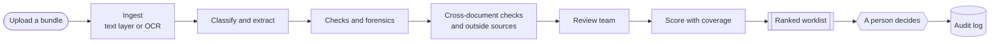

<h3>Upload a bundle of documents. Get a ranked queue of cases, with the evidence behind every flag.</h3>

  
  
  
  
  
  

  
  
  
  

[Features](#key-features) · [See it](#see-it) · [How it works](#how-it-works) · [Try it](#try-it) · [Results](#results) · [Contributors](#contributors)

---

## Key features

Fraud Desk reads a bundle of documents, runs the checks an analyst would do by hand, and ranks the cases that need a person.

  
  
  
  
  

 

<table>
  <tr>
    <td valign="top" width="50%">
      <h4>🎯 Riskiest cases first</h4>
      A score and a one-line plain-English reason for every case, so the analyst opens the right one next. People make every decision.
    </td>
    <td valign="top" width="50%">
      <h4>🔎 Evidence you can see</h4>
      Each flag is drawn on the exact figure on the exact page. Every score shows its coverage: which checks ran and which pages went unreviewed.
    </td>
  </tr>
  <tr>
    <td valign="top">
      <h4>🧪 69 rule-based checks plus 5 model-based</h4>
      Across 13 document types: statement, invoice, receipt and financial-statement arithmetic, ID and ownership records, cross-document reconciliation, name matching, file forensics. The model-based checks read meaning and quote the text they rely on. Optional outside sources: ACRA, sanctions lists, GLEIF (<a href="docs/verification-sources.md">details</a>).
    </td>
    <td valign="top">
      <h4>🧩 Write your own check</h4>
      In the Check catalogue, describe a check in plain English. A fixed engine runs it, shows exactly what it will and will not check, and tests it on stored cases first. Anything it cannot do goes to the tech team as a request (<a href="docs/custom-rules.md">details</a>).
    </td>
  </tr>
  <tr>
    <td valign="top">
      <h4>👥 Review team and audit trail</h4>
      Four specialist reviewers and a case officer summarise each flagged case. Verdicts need a reason, high-severity dismissals need a second approver, and everything lands in an append-only log (<a href="docs/agents.md">details</a>).
    </td>
    <td valign="top">
      <h4>🔒 Safe by design</h4>
      Encrypted at rest, red-teamed with 71 forgery attacks, per-case and per-day spend caps, and it can run fully in-house on a local model (<a href="docs/red-team.md">red team</a>, <a href="docs/local-llm.md">local model</a>).
    </td>
  </tr>
</table>

Numbers are measured on fictitious test documents; see [Results](#results) for the method and the misses.

## See it

  
   <b>The worklist.</b> Riskiest first, with the reason and how many checks ran.

 

  
   <b>A case.</b> The score, the reasons, and the flagged figure highlighted on the document.

On a phone, and the control-performance page

  
  &nbsp;&nbsp;
  

  

*Screenshots show built-in mock data. Everything is fictitious.*

## How it works

PDFs and images are read from the text layer first, then by OCR (Tesseract) for scans, and Claude Haiku 5.5 turns the text into fields. All extracted text is untrusted input, and the model has no tools: it can only fill a schema.

## Try it

A hosted demo is open to invited testers. Use the demo cases in the worklist, or make your own fictitious documents (a word processor and "save as PDF" is enough) and change an amount, paste in a page from another file, or try an odd layout.

**Fictitious documents only.** Page text and images are sent to a third-party model for reading. Share what you find with the [*Test result* template](https://github.com/yekaiwu/fraud-desk/issues/new/choose); for security issues see [SECURITY.md](SECURITY.md).

## Results

Measured on fictitious test documents ([method](docs/test-data-and-eval.md)).

| What was measured | Result |
|:--|:--|
| Digital PDFs: tampered cases caught | 464 / 465 (development seed), 465 / 465 (held-out seed) |
| Digital PDFs: clean bundles falsely flagged | 0 / 33 |
| Scans: tampered bundles caught | 38 / 40 |
| Scans: clean bundles falsely flagged | 3 / 75 |
| Cost per case with Haiku | about 1 cent digital, about 10 cents scanned |

## For developers

Start at [docs/README.md](docs/README.md) (architecture, data model, API, evaluation design) and [docs/limitations.md](docs/limitations.md). To contribute, see [CONTRIBUTING.md](CONTRIBUTING.md). To run it yourself, see [docs/deploy.md](docs/deploy.md).

## Contributors

<table>
  <tr>
    <td align="center" width="140">
       
      <a href="https://github.com/yekaiwu"><b>@yekaiwu</b></a>
    </td>
    <td align="center" width="140">
       
      <a href="https://github.com/kenzieyii"><b>@kenzieyii</b></a>
    </td>
    <td align="center" width="140">
       
      <a href="https://github.com/AnandaTris"><b>@AnandaTris</b></a>
    </td>
    <td align="center" width="140">
       
      <a href="https://github.com/Galiative"><b>@Galiative</b></a>
    </td>
    <td align="center" width="140">
       
      <a href="https://github.com/jia4152"><b>@jia4152</b></a>
    </td>
  </tr>
</table>

## License

[MIT](LICENSE). Copyright (c) 2026 yekaiwu.

Fraud Desk is a research prototype that supports human reviewers. All data shown is fictitious.

